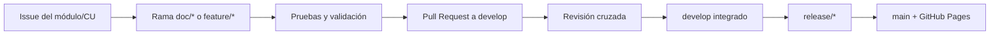

# Flujo de Trabajo — VetCare

Este documento establece las normas para contribuir al proyecto **VetCare**, sistema web de gestión de citas y pacientes de la clínica veterinaria **Huellitas**, desarrollado para la asignatura **Desarrollo de Aplicaciones Web**.

> Un buen flujo de trabajo garantiza organización, estandarización, colaboración, trazabilidad y calidad.

## Tabla de contenidos

- [Asignación de tareas](#asignación-de-tareas)
- [Dependencias e integración](#dependencias-e-integración)
- [Calendario](#calendario)
- [Gitflow](#gitflow)
  - [Estrategia de ramificación](#estrategia-de-ramificación)
  - [Diagrama del flujo](#diagrama-del-flujo)
- [Pull Requests](#pull-requests)
- [Reglas de trazabilidad y consistencia](#reglas-de-trazabilidad-y-consistencia)
- [Criterios técnicos y de calidad](#criterios-técnicos-y-de-calidad)
- [Resolución de conflictos](#resolución-de-conflictos)

## Asignación de tareas

El proyecto se organiza mediante un **modelo incremental**, con siete módulos distribuidos entre cuatro estudiantes. Cada incremento comprende **requisitos, diseño, implementación y pruebas**. El trabajo es paralelo cuando las dependencias lo permiten.

| Estudiante | Módulo | Responsabilidad | Casos de uso | Actor principal | Entidades de referencia | Operaciones representadas |
| --- | --- | --- | --- | --- | --- | --- |
| **Luis** | **M1** | Acceso y seguridad; inicio de sesión y plantilla visual base | CU-01 | Todos | Usuario | Pantalla de login y menús según rol |
| **Luis** | **M2** | Propietarios | CU-02 | Recepcionista | Propietario | Crear, consultar, editar y confirmar eliminación |
| **Jorge** | **M3** | Mascotas e información de historial clínico | CU-03 | Recepcionista | Mascota, HistoriaClinica | CRUD de mascotas; estructura y navegación del historial coordinadas con M5 |
| **Jorge** | **M4** | Citas: transacción central | CU-04, CU-05 | Recepcionista | Cita | Agendar, consultar, reprogramar y cancelar |
| **Mayerly** | **M5** | Atención clínica | CU-06, CU-07, CU-08 | Veterinario | Atencion | Consultar agenda, registrar atención y consultar historial |
| **Anderson** | **M6** | Personal | CU-09; CU-11 pendiente de definición | Administrador | Veterinario, Recepcionista | CRUD de veterinarios; alcance de CU-11 por confirmar |
| **Anderson** | **M7** | Catálogo de servicios | CU-10 | Administrador | Servicio | Crear, consultar, editar y confirmar eliminación |

**Aclaración de alcance:** el enunciado oficial especifica CU-01 a CU-10. La asignación de equipo incluye **CU-11**, pero no aporta su nombre, flujos ni validaciones. Este caso se mantendrá **pendiente de definición y aprobación**; no debe considerarse un requisito oficial implementado hasta documentarlo. Tampoco se debe presentar como requisito obligatorio un CRUD de recepcionistas que el PDF no describe.

La responsabilidad de **M3** sobre la información de historia clínica no modifica los actores definidos en los casos de uso: **CU-08, consultar historial clínico, corresponde al veterinario y se implementa funcionalmente en M5**. Jorge y Mayerly deben acordar la estructura y las pantallas relacionadas.

La plantilla y las reglas visuales comunes de M1 son responsabilidad inicial de Luis, pero **todo el equipo debe acordar y respetar el estilo compartido**. El responsable de integrar y revisar las entregas globales se designará por acuerdo del equipo; no se presume que exista un quinto rol.

## Dependencias e integración

La operación principal del proyecto es **agendar una cita (M4 / CU-04)**, para la cual deben existir previamente las pantallas y los datos de ejemplo de:

- **M2:** propietario asociado a la cita.
- **M3:** mascota asociada al propietario.
- **M6:** veterinario disponible como opción del formulario.
- **M7:** servicio seleccionable con su precio.

**M1** aporta la plantilla base y la navegación por roles. **M5** consulta citas y mascotas para representar la agenda, la atención médica y el historial clínico, por lo que debe coordinar sus interfaces con **M3 y M4**.


Antes de integrar, los responsables deben acordar **nombres de archivos HTML, rutas relativas, elementos del menú, datos de ejemplo, convenciones CSS y destinos de formularios**. Por tratarse de un sitio estático, estos contratos son de **navegación y presentación**, no de API ni de base de datos.

## Calendario

**Fecha límite oficial:** miércoles **18 de noviembre de 2026, 23:59**. Los hitos anteriores son una **propuesta interna de coordinación**, no fechas impuestas por el enunciado.

### 10-11-2026 — Requisitos y acuerdos de integración

- **Luis:** especificar CU-01 y CU-02; definir estructura general de la plantilla por rol.
- **Jorge:** especificar CU-03, CU-04 y CU-05; identificar dependencias de las citas.
- **Mayerly:** especificar CU-06, CU-07 y CU-08; coordinar los datos clínicos con M3 y M4.
- **Anderson:** especificar CU-09 y CU-10; solicitar definición formal de CU-11 antes de incorporarlo.
- **Equipo:** construir la visión, identificar reglas de negocio y aplicar la priorización **MoSCoW** con valor, esfuerzo, justificación y responsable.

### 12-11-2026 — Diseño

- **Luis:** plantilla compartida, inicio de sesión simulado, menú por rol y pantallas CRUD de propietarios.
- **Jorge:** pantallas de mascotas y citas; transiciones desde propietarios, veterinarios y servicios.
- **Mayerly:** vistas de agenda, registro de atención e historial clínico.
- **Anderson:** pantallas de gestión de veterinarios y servicios.
- **Equipo:** consolidar el diagrama de casos de uso **UML 2.5** y el **mapa navegacional** con nombres exactos de archivos; acordar variables y estilos CSS comunes.

### 16-11-2026 — Implementación e integración

- **Luis:** entregar M1 y M2; verificar navegación general y estructura visual compartida.
- **Jorge:** entregar M3 y M4; verificar la selección de propietario, mascota, veterinario y servicio al simular el agendamiento.
- **Mayerly:** entregar M5; verificar las transiciones agenda → atención → historial.
- **Anderson:** entregar M6 y M7 según el alcance documentado; verificar datos y enlaces utilizados por M4.
- **Equipo:** integrar mediante Pull Requests a `develop` y comprobar que el mapa navegacional coincide con los archivos existentes.

### 17-11-2026 — Pruebas y documentación final

- **Cada responsable:** revisar formularios, enlaces, datos de ejemplo, estilos y pantallas de sus módulos en **Chrome y Firefox**.
- **Equipo:** validar HTML y CSS con los validadores W3C, verificar como mínimo **18 pantallas**, comprobar los casos de uso clasificados como **Must**, consolidar el PDF de los entregables **3.1 a 3.5** en `docs/` y preparar la publicación.
- **Revisor de integración designado:** verificar la consistencia entre documentación, navegación y sitio estático.

### 18-11-2026 — Publicación y entrega

- Integrar una versión revisada desde `develop` a `main` mediante `release/*`.
- Publicar el sitio estático en **GitHub Pages**.
- Verificar el funcionamiento de la URL pública, el documento PDF y el `README.md`.
- Entregar en el aula virtual **la URL del repositorio y la URL del sitio**, antes de las **23:59**.

## Gitflow

Para cada tarea del hito se seguirá esta secuencia:


3. Crear o actualizar una rama de trabajo a partir de `develop`.
4. Elaborar la especificación, las pantallas o las pruebas del incremento, según corresponda.
5. Verificar las reglas técnicas y la navegación; registrar los cambios con **Conventional Commits**.
- Los commits deben seguir [Conventional Commits](https://www.conventionalcommits.org/en/v1.0.0/) (`feat`, `fix`, `docs`, `style`, `refactor`, etc.).
6. Abrir un **Pull Request hacia `develop`**, 

8. Integrar módulos dependientes solo después de acordar los archivos, datos y enlaces compartidos.

Cuando el contenido esté validado en `develop`, se preparará `release/*` y se fusionará a `main` para la versión de entrega.

### Estrategia de ramificación

| Rama o patrón | Uso |
| --- | --- |
| `main` | Versión revisada y publicable mediante GitHub Pages |
| `develop` | Integración de incrementos del equipo |

| `feature/<nombre>`,| Pantallas HTML5 y estilos CSS de cada módulo |

| `release/*` | Revisión y preparación de la versión final |
| `hotfix/*` | Correcciones urgentes sobre una versión publicada |

Los nombres indicados son **convenciones propuestas**, no ramas que ya estén creadas. Para evitar conflictos, el equipo puede añadir un número de Issue al nombre (por ejemplo, `feature/m4-citas-23`) y eliminar la rama tras fusionarla. No es obligatorio mantener activas catorce ramas en paralelo.

Ejemplo de comandos para una tarea nueva:

```bash
git switch develop
git pull origin develop
git switch -c feature/m4-citas-23
# Editar únicamente los archivos relacionados con la tarea.
git add .
git commit -m "feat(citas): agregar formulario de agendamiento"
git push -u origin feature/m4-citas-23
```

El comando `git add .` debe ejecutarse **solo después de revisar** `git status` y `git diff`, para no incluir cambios ajenos o archivos temporales.

### Diagrama del flujo



## Pull Requests

Cada Pull Request debe utilizar [PULL_REQUEST_TEMPLATE.md](./PULL_REQUEST_TEMPLATE.md) y declarar **módulo, CU relacionado, Issue, responsable, dependencias y evidencia de comprobación**. No se fusionarán cambios con enlaces rotos ni formularios que incumplan validaciones comprobables con HTML5.

## Reglas de trazabilidad y consistencia

- Todo caso de uso debe conservar su identificador (`CU-01`, `CU-02`, etc.) y concordar con la especificación, el diagrama UML y el mapa navegacional.

## Criterios técnicos y de calidad

**Restricción obligatoria:** utilizar únicamente **HTML5 y CSS/CSS3**. **No** utilizar JavaScript, Bootstrap, Tailwind, otros frameworks de CSS ni backend. Las operaciones CRUD y el login se **simulan mediante pantallas estáticas**, sin persistencia ni autenticación real.

- `index.html`: acceso simulado; `pages/`: pantallas adicionales; `css/`: estilos externos; `img/`: imágenes; `docs/`: PDF de entregables.
- HTML con `<!DOCTYPE html>`, `lang="es"`, metadatos requeridos y etiquetas semánticas coherentes.
- Tablas accesibles (`caption`, `thead`, `tbody`, `th` con `scope`) y formularios con `label` asociado, `fieldset` y `legend` cuando correspondan.
- Usar en el conjunto del sistema los controles HTML5 solicitados: `email`, `tel`, `password`, `date`, `time`, `number`, `search`, `radio`, `checkbox`, `select`, `textarea` y `datalist`.
- Validar con atributos HTML5 como `required`, `pattern`, `title`, `min`, `max`, `step`, `minlength`, `maxlength`, `placeholder` y `autocomplete` conforme a las reglas de negocio; no utilizar `novalidate`.
- Ejemplos de reglas: cédula de **10 dígitos**; celular de **10 dígitos que empieza con 09**; nombres y apellidos con letras y espacios y longitud de **2 a 50 caracteres**; peso de mascota de **0,1 a 120 kg**, con un decimal; servicio con precio de **USD 1 a USD 500**.
- Representar citas de **lunes a sábado, de 08:00 a 18:00, en bloques de 30 minutos**, sin fechas pasadas. Estados: **Programada**, **Atendida**, **Cancelada**; esta última requiere motivo de hasta **200 caracteres**.
- Para **Create**, usar formulario vacío y destino de navegación; para **Read**, tabla de ejemplos y buscador; para **Update**, formulario con datos precargados; para **Delete**, pantalla de confirmación. La cancelación de citas sigue su propio flujo y no equivale a eliminar el registro.
- Utilizar variables `:root`, Flexbox, Grid, **al menos dos puntos de quiebre** `@media`, pseudoclases de validación y estados interactivos; no emplear estilos en línea `style="..."`.
- Verificar contraste legible conforme a WCAG AA; utilizar selectores de atributo, `:nth-child()`, transiciones y al menos una fuente web.
- Verificar todas las pantallas en **Chrome y Firefox** y validar HTML y CSS en los validadores W3C sin errores.

**Limitación técnica que debe documentarse:** sin JavaScript ni servidor, las comprobaciones dinámicas o entre registros (por ejemplo, evitar solapamientos reales, comprobar automáticamente la fecha actual o relacionar una atención guardada con una cita) no pueden ejecutarse plenamente. Deben representarse de manera coherente con pantallas y datos de ejemplo; no se debe afirmar que existe persistencia o validación de negocio automatizada cuando no es así.

## Resolución de conflictos

- Resolver conflictos en la rama de trabajo, sin sobrescribir archivos de otros integrantes sin coordinación previa.
- Antes de sincronizar cambios compartidos, avisar a quienes trabajan en la plantilla, los estilos o las rutas del mismo módulo.
- Tras resolver un conflicto, volver a comprobar formularios, enlaces y estilos en Chrome y Firefox.
- El revisor de integración verificará que la solución no afecte los demás módulos ni rompa el mapa navegacional.
